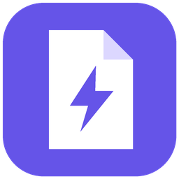

<p align="center"></p>
<h1 align="center">PDF Superapp</h1>
<p align="center">A local Windows desktop toolkit for everyday PDF tasks.</p>

PDF Superapp combines document conversion, image-to-PDF conversion, and PDF password removal in one interface. Files are processed locally. No sign-in, uploads, Microsoft Word, or LibreOffice is required. Installing dependencies requires internet access; conversion does not.

## Features

- **Compress PDF:** adjustable 1–100% compression strength and a measured local trial estimate. The percentage is strength, not a guaranteed reduction. Higher settings reduce image quality; text remains text. Already optimized files may not shrink.
- **Merge PDFs:** combine two or more PDFs in the listed order.
- **Add PDF password:** require a new password to open the output, using AES-256.
- **Split PDF:** extract page ranges (e.g. `1-3,5`) into one PDF, or export each selected page into a ZIP. Blank page ranges mean all pages.
- **Edit PDF:** overlay Latin-1 text, rotate selected pages by 90/180/270 degrees, or delete pages from a new copy. Text positions use points (72 per inch) from the unrotated page’s top-left. Existing text cannot be rewritten or redacted.
- **Word to PDF:** DOCX and UTF-8 TXT, including basic text, tables, and inline images.
- **PDF to Word:** export extracted editable text and images to DOCX, or preserve page appearance as images.
- **Images to PDF:** combine images in the chosen order. Supports common Pillow-readable formats including JPEG, PNG, BMP, GIF, TIFF, WebP, HEIC/HEIF, and AVIF where the installed decoder supports them. All animation and TIFF frames are included.
- **Remove PDF password:** supply the current password to save an unencrypted copy.
- Sidebar navigation, file reordering, progress feedback, password visibility control, and an output-folder shortcut.

Source files cannot be selected as the output. Existing outputs are replaced after the save dialog confirmation and successful conversion.

## Run from source

Developed and checked on Windows 11 with Python 3.14. Other Python versions and operating systems have not been verified.

```powershell
python -m venv .venv
.\.venv\Scripts\python.exe -m pip install -r requirements.txt
.\.venv\Scripts\python.exe superapp.py
```

Keep `logo.png` alongside `superapp.py`.

## Build the Windows desktop app

From a PowerShell terminal with your Python environment active:

```powershell
.\build.ps1
```

The app is created in `dist/PDF Superapp/`. Open `PDF Superapp.exe`. Keep the entire folder, including `_internal`, together. The packaged app includes Python and its runtime dependencies and works independently of ChatGPT.

If PowerShell prevents running scripts, run the commands in `build.ps1` individually in your terminal.

## Use

1. Select a tool in the sidebar.
2. Browse for an input file. For images, add multiple files and reorder them.
3. Enter the current PDF password if needed, or select appearance preservation for PDF-to-Word.
4. Choose **Convert and save**, then choose a new output path.
5. Use **Open output folder** after conversion finishes.

## Limitations

- DOCX conversion is basic. Complex formatting, headers, footers, fields, fonts, and page layout may change. Legacy `.doc` files are not supported.
- PDF-to-Word does not reconstruct complex tables and layouts reliably. Scanned text is not made editable: OCR is not included. Appearance mode embeds page images.
- Not every image format is supported. Camera RAW, SVG, and proprietary formats may fail. Transparency is placed on white.
- Password removal requires a valid current password; this app does not crack or recover forgotten passwords. Use it with files you own or are authorized to modify.

## PDF tool details

Use **Estimate output size** after choosing a PDF and a compression strength. The app performs a temporary compression locally and reports the measured estimate. The final size is shown after saving. A strength of 100% does not mean a 100% reduction.

For encrypted inputs, supply the current password. Merging accepts a shared password; unlock files separately first if their passwords differ. Compression, merging, splitting, editing, and password removal create unencrypted outputs. Use **Add PDF password** to protect an output. New passwords must match their confirmation and fit within 127 UTF-8 bytes.

To run the PDF operation tests:

```powershell
python -m unittest discover -s tests -v
```

## Checks performed

Sample checks covered DOCX-to-PDF, both PDF-to-DOCX modes, image-to-PDF, password removal including AES-256, wrong-password output preservation, and source overwrite protection. UI checks covered tool switching, file ordering/removal, and minimum-window layout. Twelve automated tests cover compression/size estimation, merge order, page ranges, ZIP splitting, AES encryption, wrong-password behavior, text overlays, rotations, deletion, and source/output preservation. This is not a comprehensive document compatibility suite.

## Dependencies and licensing

The application uses PyMuPDF, python-docx, Pillow, pillow-heif, ReportLab, pypdf, and cryptography; PyInstaller packages the Windows application. Their respective licenses continue to apply. Review the upstream license files before redistributing bundled software. No separate license for this project's original source has been selected.
